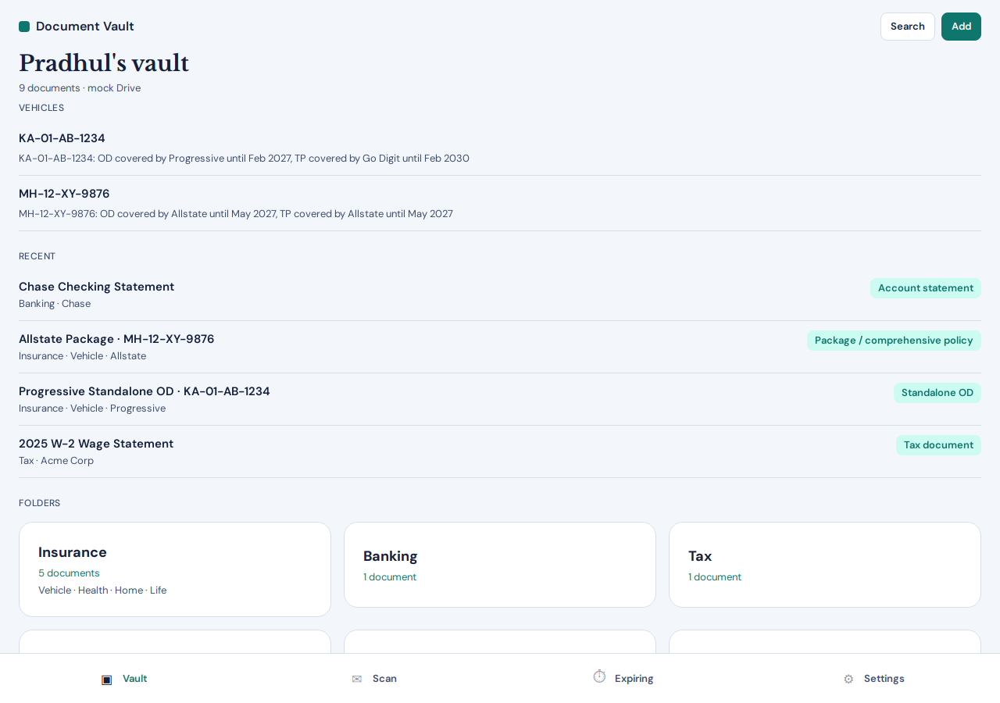
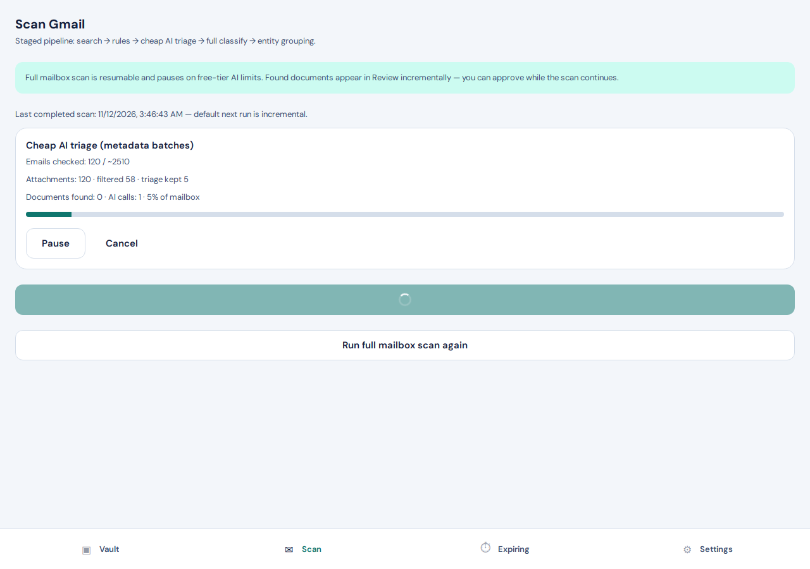
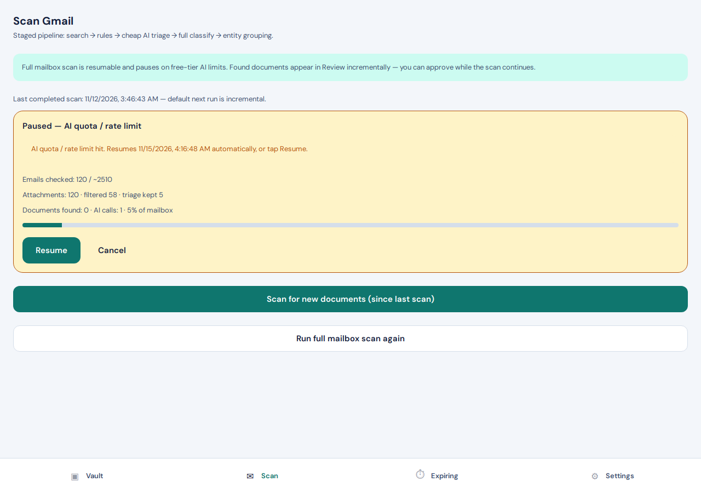
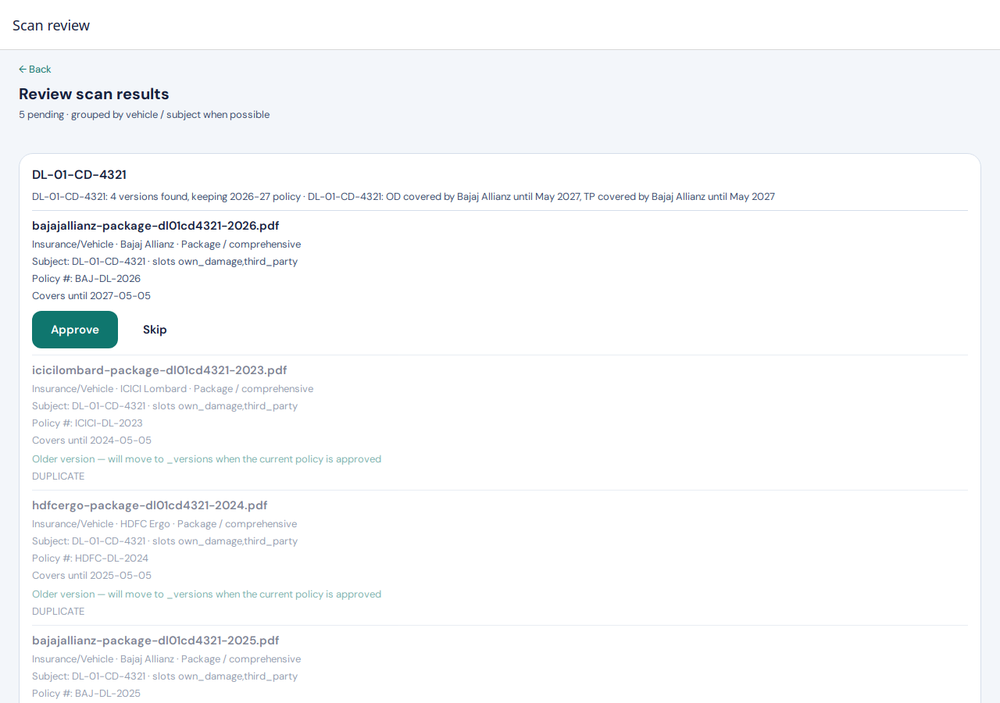
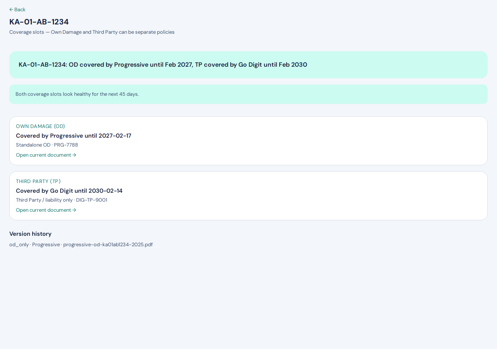

# Document Vault

**v0.1.0 (pre-release)** — a self-contained personal document vault built with **Expo (React Native + TypeScript + Expo Router)**. One codebase runs on **iOS, Android, and web**.

There is **no app-owned backend or database**:

- Files live in **your Google Drive** (`drive.file` — only files this app creates)
- Email scanning uses **Gmail** (`gmail.readonly`)
- AI uses a **bring-your-own key** (Gemini by default). Keys stay on-device

By default the app runs in **mock mode** so you can exercise every screen without Google or AI credentials.



---

## Features

- **Add documents** — pick PDF/image; AI or rules suggest category/title/metadata; save into the right Drive folder
- **Per-document Sync** — search Gmail for a newer version of the same *subject* (e.g. vehicle registration), not just policy number; keep history in `_versions`
- **Full resumable Gmail scan** — all-time first run; staged pipeline (search → rules → batched metadata AI triage → classify → entity grouping); Drive-persisted scan state; quota pause/resume; incremental review
- **Entity-aware grouping** — group by registration / chassis / …; keep latest (or per coverage slot); older versions → history; ambiguous subjects flagged in review
- **Vehicle OD/TP coverage slots** — package vs Standalone OD vs Liability Only / Act Only; long-term TP + annual OD; vehicle cover view
- **Browse / search / expiring** — folders, vehicles list, metadata search, per-slot expiry gaps
- **Settings** — paste Gemini (or other) API key; usage / queue / 429 backoff

| Scan progress | Quota pause | Grouped review |
| --- | --- | --- |
|  |  |  |



---

## Quick start (mock mode)

```bash
npm install
npm run web          # http://localhost:43123
npm test
npm run typecheck
```

Native:

```bash
npm start            # then press i / a, or scan QR with Expo Go
```

Copy env placeholders (optional in mock mode):

```bash
cp .env.example .env
```

Set `EXPO_PUBLIC_USE_MOCKS=false` and fill OAuth client IDs when you want real Google APIs. Paste AI keys in **Settings** (never commit them).

---

## Full resumable mailbox scan

First run offers **Full mailbox scan** (all-time `has:attachment` — no `after:`) or a lookback window. Later runs default to **incremental** (since `lastScanAt`).

Pipeline (persisted to Drive `scan-state.json` + local cache after every step):

1. **Search** — paginated Gmail listing (page token saved for resume)
2. **Rule pre-filter** — drop logos, tiny images, obvious promos (no AI)
3. **Cheap AI triage** — batched metadata-only (`from` / `subject` / `filename` / `snippet`)
4. **Classify** — download + full AI classify; candidates appear in Review incrementally
5. **Entity grouping / dedupe** — subject-key groups; older → `_versions` on approve

Quota / free-tier 429 pauses the job (`paused_quota`) with Resume. User Pause also persists across restarts.

---

## Entity-aware grouping & vehicle cover

Documents group by **document-type family + subject key**, not policy number — renewals and insurer switches stay one entity.

Review example: `DL-01-CD-4321: 4 versions found, keeping 2026-27 policy`

Vehicle insurance uses generic coverage slots `own_damage` and `third_party`:

- **Comprehensive / Package / Bundled** → both slots
- **Standalone OD** → `own_damage` only
- **Liability Only / Act Only / TP** → `third_party` only

A vault can hold several *current* docs per vehicle (e.g. 5-year TP + annual OD). Newer comprehensive supersedes both slots; newer OD-only leaves an active long-term TP alone.

---

## Architecture

| Module | Role |
|--------|------|
| `src/services/auth` | Google OAuth (+ mock), token refresh |
| `src/services/drive` | Vault folders, uploads, `vault-index.json`, `scan-state.json` |
| `src/services/gmail` | Attachment search + download |
| `src/services/ai` | Pluggable providers + request queue / rate limits |
| `src/services/scanEngine` | Resumable staged mailbox scan |
| `src/lib/*` | Matching, dedupe, versioning, subject keys, coverage slots, scan pipeline |
| `src/app/*` | Expo Router screens |

**Scopes:** `drive.file` + `gmail.readonly` (restricted). We do **not** request full Drive access.

---

## Google Cloud setup

1. Create a Google Cloud project; enable **Gmail API** and **Google Drive API**
2. Configure OAuth consent (Testing + test users first)
3. Create OAuth client IDs (Web / iOS / Android) — use PKCE; **no client secret in the app**
4. Put public client IDs in `.env` (see `.env.example`)
5. Optional: create a [Gemini API key](https://aistudio.google.com/apikey) and paste it in Settings

`gmail.readonly` requires Google verification before production for arbitrary users. See [restricted scope verification](https://support.google.com/cloud/answer/9110914).

---

## Scripts

| Script | Purpose |
|--------|---------|
| `npm run web` | Web dev server on port **43123** |
| `npm start` | Expo dev tools |
| `npm test` | Jest unit tests |
| `npm run typecheck` | `tsc --noEmit` |
| `npm run web:export` | Static web export to `dist/` |

---

## Known limitations

- **Mock mode by default** — no real Gmail/Drive/AI until you configure env + keys
- **Gmail restricted-scope verification** blocks public OAuth until Google approves the app
- **Free-tier AI caps** — scan pauses on quota; large mailboxes need multiple resume cycles
- Web mock vault uses `localStorage`; native mocks are in-memory for the process
- Prefer Gemini for PDF/image multimodal classification

---

## License

[MIT](LICENSE) © 2026 Pradhul

See [CHANGELOG.md](CHANGELOG.md) for release history.
